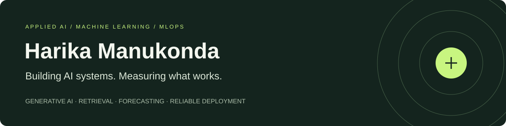

# Hi, I’m Harika

**AI/ML Engineer · Data Scientist · MLOps Specialist**

I build AI systems that connect data, models, and useful applications. My professional experience spans healthcare, travel, and technology, with a focus on generative AI, retrieval-augmented generation, forecasting, and production ML workflows.

Here, I share independent projects with runnable code, baseline comparisons, evaluation reports, and documented failure cases.

[Explore my repositories](https://github.com/harikamanukonda?tab=repositories) · [LinkedIn](https://www.linkedin.com/in/harikamanu7/) · [Get in touch](mailto:haarikamanukonda@outlook.com)

## Featured projects

| Project | What you can explore | Evidence |
| --- | --- | --- |
| **[Multimodal Document Intelligence](https://github.com/harikamanukonda/evidence-document-assistant/tree/main/multimodal)** | PDF and image retrieval with CLIP, table extraction, text/visual/hybrid comparisons, and source-page citations | [Retrieval evaluation](https://github.com/harikamanukonda/evidence-document-assistant/blob/main/reports/multimodal-evaluation.json) · [Preview](https://github.com/harikamanukonda/evidence-document-assistant/blob/main/reports/multimodal-preview.png) |
| **[Agent Reliability Benchmark](https://github.com/harikamanukonda/agent-reliability-benchmark)** | Sandboxed tool use, prompt-injection scenarios, retries, approval checks, and actual open-model trajectories | [Model results and failures](https://github.com/harikamanukonda/agent-reliability-benchmark/blob/main/reports/local-model.json) |
| **[Time-Series Foundation Model Benchmark](https://github.com/harikamanukonda/supply-chain-intelligence/tree/main/benchmark)** | Chronos-Bolt Tiny versus three conventional baselines on public data, with rolling validation and interval metrics | [Measured benchmark](https://github.com/harikamanukonda/supply-chain-intelligence/blob/main/reports/foundation-benchmark.json) |
| **[ML Monitoring Lab](https://github.com/harikamanukonda/ml-monitoring-lab)** | Controlled feature/concept drift, candidate retraining, and a held-out validation gate for simulated promotion | [Experiment output](https://github.com/harikamanukonda/ml-monitoring-lab/blob/main/reports/example.json) · [Dashboard](https://github.com/harikamanukonda/ml-monitoring-lab/blob/main/reports/dashboard.png) |

These are independent demonstrations using public data, synthetic data, or fictional documents. Employer code and data are not included. Each repository explains its evaluation scope and limitations.

## Technical toolkit

| Area | Technologies |
| --- | --- |
| **Languages & data** | Python, SQL, Pandas, NumPy, PySpark, Snowflake, Airflow |
| **Machine learning** | PyTorch, TensorFlow, Scikit-learn, XGBoost, forecasting, model evaluation |
| **Generative AI** | LangChain, LangGraph, Hugging Face, RAG, FAISS, ChromaDB, Amazon Bedrock, MCP |
| **Deployment & operations** | FastAPI, Docker, Kubernetes, AWS, Azure ML, MLflow, Langfuse, GitHub Actions |

## Professional background

- **McKesson · AI/ML Engineer / Data Scientist** — healthcare forecasting, agentic RAG, evaluation, and model observability.
- **Airbnb · AI/ML Engineer** — scalable ML pipelines, forecasting, and real-time inference.
- **Dell Technologies · ML Engineer** — ML pipeline automation, model deployment, and performance monitoring.

**Education:** Master’s in Information Systems, Saint Louis University · GPA 3.8/4.0.

## How I approach projects

Start with a reproducible baseline, keep evaluation data separate, and inspect where the model fails. Document the data, assumptions, tradeoffs, and limits so another engineer can reproduce the result.

## Connect

I’m interested in applied AI, generative AI, and ML platform engineering.

[LinkedIn](https://www.linkedin.com/in/harikamanu7/) · [Email](mailto:haarikamanukonda@outlook.com)
